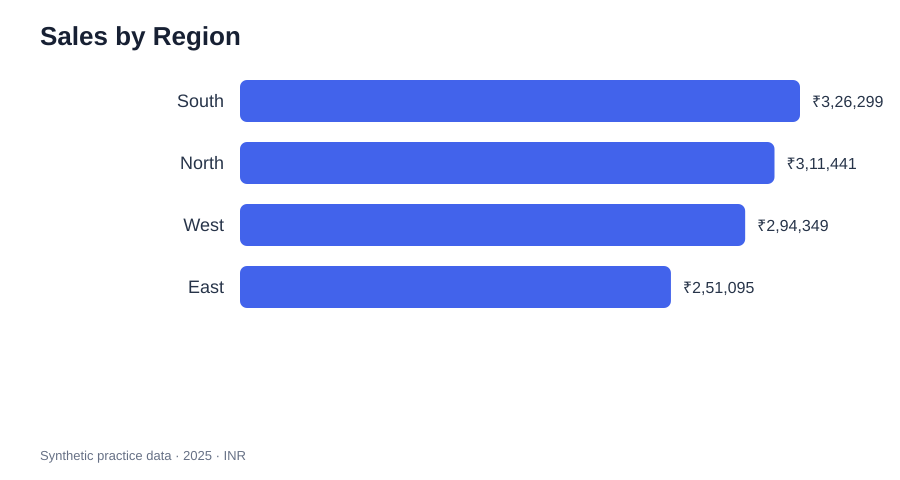
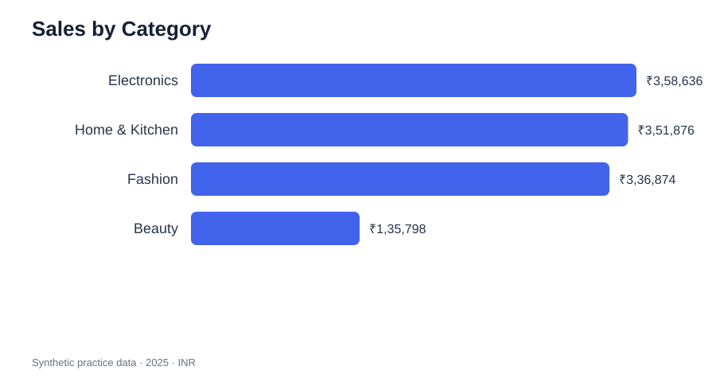
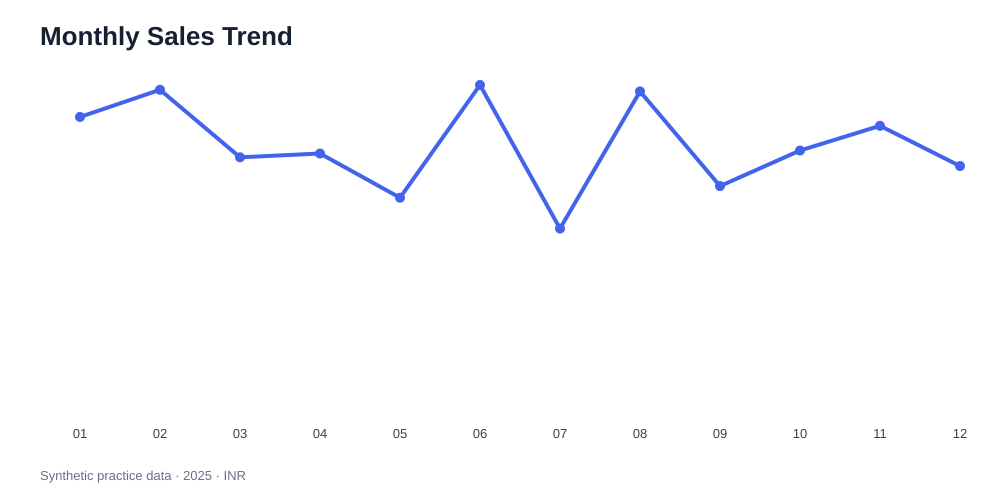
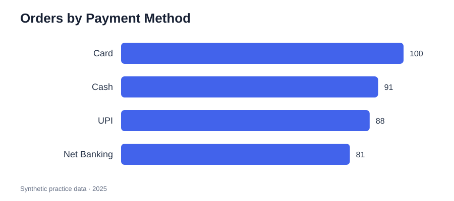

# Atelier Retail Sales Analytics

A reproducible retail analytics portfolio project built with **Python, pandas, SQL and data visualisation**. It demonstrates data validation, KPI development, segmentation, time-series summaries, SQL analysis and business communication.

> **Data transparency:** the 360-row dataset is synthetic practice data generated for this portfolio. It is not from a real company and contains no real customer information. Profit and profit margin are illustrative estimates based on assumed category cost ratios, not audited accounting results.

## Project questions

- What are total sales, estimated profit, units sold and average order value?
- Which regions and product categories contribute most to sales?
- How do sales change month by month?
- Which products and payment methods lead the sample?
- How can the results be translated into practical business questions?

## Verified dataset profile

| Check | Result |
|---|---:|
| Records / unique order IDs | 360 / 360 |
| Date coverage | 2025-01-01 to 2025-12-31 |
| Missing values | 0 |
| Duplicate order IDs | 0 |
| Sales formula mismatches | 0 |
| Units sold | 1,083 |
| Sales after discounts | ₹11,83,184.10 |
| Illustrative estimated profit | ₹5,11,709.71 |
| Average order value | ₹3,286.62 |

## Key sample observations

- **South** is the largest sales region in this sample (₹3,26,299.00).
- **Electronics** is the largest category by sales (₹3,58,636.45).
- **June 2025** is the strongest month by sales (₹1,21,253.65).
- **Card** is the most frequent payment method (100 of 360 orders).

These describe only the synthetic dataset and should not be interpreted as market or company performance.

## Visual overview









## Repository structure

```text
Atelier-RS41-Sales-Analytics/
├── data/
│   ├── retail_sales.csv
│   └── DATA_DICTIONARY.md
├── reports/
│   ├── initial_analysis.md
│   └── business_insights.md
├── sql/analysis_queries.sql
├── tests/test_analysis.py
├── analysis.py
├── requirements.txt
└── README.md
```

## Run the analysis

1. Install Python 3.10 or newer.
2. Create a virtual environment: `python -m venv .venv`.
3. Activate it (Windows: `.venv\\Scripts\\activate`; macOS/Linux: `source .venv/bin/activate`).
4. Install packages: `pip install -r requirements.txt`.
5. Run: `python analysis.py`.
6. Run tests: `python -m unittest discover -s tests -v`.

The analysis validates the source data, prints KPI and segment summaries, writes six summary CSVs to `outputs/`, and exports four PNG charts to `outputs/charts/`.

## Power BI dashboard

A Power BI Desktop dashboard build guide and DAX starter measures are available in [`powerbi/`](powerbi/). Follow [`powerbi/POWER_BI_GUIDE.md`](powerbi/POWER_BI_GUIDE.md) to import the CSV, create the Calendar relationship, build KPI measures, and assemble the interactive report. The editable `.pbix` is created locally in Power BI Desktop; it is not included until it has been built and reviewed.

## SQL

Import `data/retail_sales.csv` into SQLite as `retail_sales`, then execute `sql/analysis_queries.sql`. The file includes KPI, regional, category, monthly, payment, product, discount-band and region-category queries.

## Skills demonstrated

Python, pandas, data validation, data cleaning principles, aggregation, KPI design, SQL, exploratory data analysis, data visualisation, unit testing, documentation and analytical storytelling.

## Limitations

- Synthetic sample with one row per order; not representative of a real retailer.
- No customer-level, inventory, returns, shipping or marketing data.
- Profit is estimated using assumptions and must not be treated as actual net profit.
- Descriptive patterns do not establish causation or forecast future performance.

## Author

Humza Warsi · [GitHub](https://github.com/HI4100) · [LinkedIn](https://www.linkedin.com/in/humza-warsi-910aa941b/)
