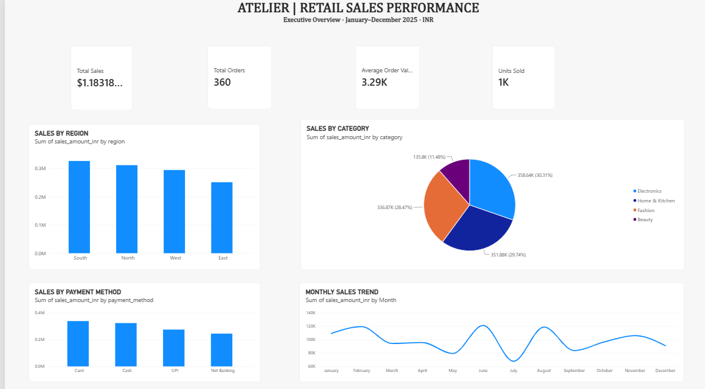
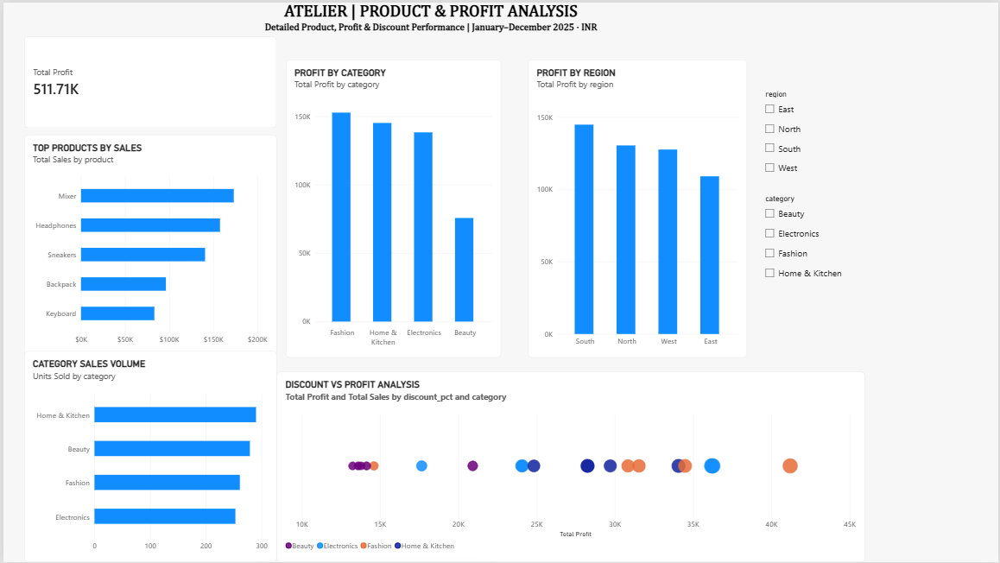

# ATELIER 41 | Retail Sales & Profit Analytics

An end-to-end retail analytics portfolio project combining **Microsoft Power BI, Power Query, DAX, Python, pandas and SQL**. The project explores a synthetic 2025 retail dataset and presents business performance through a two-page interactive dashboard.

> **Data transparency:** All transaction data is synthetic practice data. It does not represent a real retailer or actual customer transactions. Profit is illustrative, calculated using assumed category cost ratios; it is not audited accounting profit.

## Dashboard preview

### Page 1 — Executive Overview



This page provides a high-level view of the dataset through four KPI cards and four analysis visuals:
- Total Sales
- Total Orders
- Average Order Value
- Units Sold
- Sales by Region
- Sales by Category
- Sales by Payment Method
- Monthly Sales Trend

### Page 2 — Product & Profit Analysis



This page explores product and profitability patterns:
- Total Profit
- Top Products by Sales
- Profit by Category
- Profit by Region
- Category Sales Volume
- Discount vs Profit Analysis
- Interactive Region and Category slicers

## What business questions does it explore?

- How much sales value and illustrative profit does the sample generate?
- How many orders and units are recorded, and what is the average order value?
- Which regions and categories contribute most to sales and estimated profit?
- Which products lead the dataset by sales?
- How do payment methods compare?
- How does sales performance vary by month?
- How do discount levels relate to sales and estimated profit in the sample?

## Dataset profile

| Measure | Verified value |
|---|---:|
| Records / unique order IDs | 360 / 360 |
| Date coverage | 2025-01-01 to 2025-12-31 |
| Missing values | 0 |
| Duplicate order IDs | 0 |
| Sales formula mismatches | 0 |
| Units sold | 1,083 |
| Total sales | ₹11,83,184.10 |
| Illustrative estimated profit | ₹5,11,709.71 |
| Average order value | ₹3,286.62 |

## Selected sample findings

- South is the highest-sales region in this synthetic dataset.
- Electronics is the highest-sales category.
- June 2025 is the highest-sales month.
- Card is the most frequent payment method, with 100 orders.

These are descriptions of this generated dataset only, not claims about an actual retailer or market.

## Technology

| Tool | Use |
|---|---|
| Microsoft Power BI Desktop | Interactive reporting and visual analytics |
| Power Query | Importing and preparing the CSV |
| DAX | KPI and aggregation measures |
| Python / pandas | Validation, summaries and reproducible analysis |
| SQL / SQLite | Structured analytical queries |
| GitHub | Version control and portfolio documentation |

## Repository contents

```text
Atelier-RS41-Sales-Analytics/
├── data/
│   ├── retail_sales.csv
│   └── DATA_DICTIONARY.md
├── dashboard/
│   └── Atelier_Retail_Sales_Analytics.pbix
├── screenshots/
│   ├── executive-overview.png
│   └── product-profit-analysis.png
├── powerbi/
│   ├── README.md
│   ├── POWER_BI_GUIDE.md
│   └── measures.dax
├── reports/
│   ├── initial_analysis.md
│   └── business_insights.md
├── sql/
│   └── analysis_queries.sql
├── tests/
│   ├── README.md
│   └── test_analysis.py
├── visualizations/
├── outputs/
├── analysis.py
└── requirements.txt
```

## Open the Power BI report

1. Download `dashboard/Atelier_Retail_Sales_Analytics.pbix`.
2. Open it using Microsoft Power BI Desktop.
3. If prompted, review the data-source path and reconnect it to `data/retail_sales.csv`.
4. Refresh the report if required.
5. Explore both report pages and use the region/category slicers on Page 2.

The PBIX is the editable report file. Screenshots above are static previews.

## Run the Python analysis

Requires Python 3.10 or newer.

```bash
python -m venv .venv
```

Windows activation:

```bash
.venv\Scripts\activate
```

Install dependencies and run:

```bash
pip install -r requirements.txt
python analysis.py
python -m unittest discover -s tests -v
```

The analysis script validates the dataset, generates KPI and segment summaries, and exports charts.

## Data quality and assumptions

The analysis checks required fields, missing data, duplicate IDs, date and numeric validity, discount bounds, positive quantities/sales, and consistency of the sales formula:

`quantity × unit_price_inr × (1 − discount_pct)`

Profit is assumption-based and included for learning dashboard analysis. It should not be treated as actual gross profit, net profit, or an audited financial measure.

## Skills demonstrated

Business Intelligence · Power BI · Power Query · DAX · KPI design · Data validation · Data cleaning · Python · pandas · SQL · Data visualization · Analytical storytelling

## Author

**Humza Warsi**  
GitHub: [HI4100](https://github.com/HI4100)  
LinkedIn: [Humza Warsi](https://www.linkedin.com/in/humza-warsi-910aa941b/)


---

<!-- ATELIER 41 | Portfolio Signature | Humza Warsi | github.com/HI4100 -->

## ✨ ATELIER 41 — Portfolio Signature

> **Build it clearly. Analyze it carefully. Test it honestly. Improve it continuously.**

**Created as part of the ATELIER 41 portfolio by Humza Warsi.** ✨

🌐 **Portfolio:** [github.com/HI4100](https://github.com/HI4100)  
📧 **Contact:** humzawarsi41@gmail.com

### 💎 ATELIER 41 Identity
**A consistent signature across my practical technology projects — where learning is demonstrated through work, documentation and continuous improvement.**

*Maybe fate brought you here for your sparkling future. ✨ Let's connect, learn and build something meaningful.* 🚀

<!-- © Humza Warsi | ATELIER 41 -->


---

## ✨ ATELIER 41 — Portfolio Signature

> **Build it clearly. Analyze it carefully. Test it honestly. Improve it continuously.**

**Created as part of the ATELIER 41 portfolio by Humza Warsi.** ✨

🌐 **Portfolio:** [github.com/HI4100](https://github.com/HI4100)  
📧 **Contact:** humzawarsi41@gmail.com

### 💎 ATELIER 41 Identity
**A consistent signature across my practical technology projects — where learning is demonstrated through work, documentation and continuous improvement.**

*Maybe fate brought you here for your sparkling future. ✨ Let's connect, learn and build something meaningful.* 🚀


---

## ✨ ATELIER 41

> **Build it clearly. Analyze it carefully. Test it honestly. Improve it continuously.**

**Humza Warsi ~ Author**  
Part of the **ATELIER 41** project collection.

🔗 Portfolio: [@HI4100](https://github.com/HI4100)

*Maybe fate brought you here for your sparkling future. ✨*
